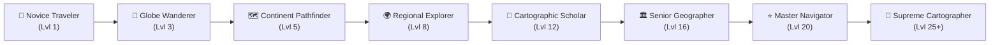

<div align="center">

  # 🌍 Country Quiz Master
  ### *The Ultimate Global Geography Challenge & Interactive World Atlas*

  [](https://react.dev/)
  [](https://vitejs.dev/)
  [](https://tailwindcss.com/)
  [](https://www.framer.com/motion/)
  [](#-progressive-web-app-pwa)
  [](LICENSE)

  <p align="center">
    <b>A high-performance, accessible, and gamified geography expedition web application.</b>
    <br />
    Explore 80+ nations, master world flags, test capital knowledge, survive sudden-death runs, and earn official cartographic certificates.
  </p>

  [Live Demo](#-getting-started) • [Key Features](#-key-features) • [Game Modes](#-game-modes) • [Controls](#-keyboard-shortcuts) • [Architecture](#-architecture)

</div>

---

## 📑 Table of Contents
- [🌟 Key Features](#-key-features)
- [🎮 Game Modes](#-game-modes)
- [🛡️ Non-Functional Excellence](#️-non-functional-excellence)
- [🎨 Dynamic Theme Engine](#-dynamic-theme-engine)
- [🏆 Achievements & Progression](#-achievements--progression)
- [⌨️ Keyboard Shortcuts](#️-keyboard-shortcuts)
- [🏗️ Architecture & Component Design](#️-architecture--component-design)
- [🚀 Getting Started](#-getting-started)
- [📦 Deployment](#-deployment)
- [📄 License](#-license)

---

## 🌟 Key Features

<table>
  <tr>
    <td width="50%">
      <h3>🚩 Global Flag Master</h3>
      Identify countries from crisp, high-resolution SVG/PNG national flags powered by proactive background preloading for instant zero-latency renders.
    </td>
    <td width="50%">
      <h3>🏛️ Capital Cities</h3>
      Alternating dual-direction matching challenges: identify countries from their capitals or test your knowledge by naming capitals of nations.
    </td>
  </tr>
  <tr>
    <td width="50%">
      <h3>📅 Seeded Daily Challenge</h3>
      A synchronized daily challenge seeded from the calendar date (<code>YYYY-MM-DD</code>). Every player across the globe plays the identical 5 questions each day.
    </td>
    <td width="50%">
      <h3>🎯 Weak Spot Revision Deck</h3>
      An intelligent spaced-revision queue that automatically remembers questions you previously missed and lets you drill them until mastered.
    </td>
  </tr>
  <tr>
    <td width="50%">
      <h3>🏆 Sudden-Death Survival</h3>
      High-stakes marathon mode. You start with 3 lives (❤️❤️❤️). Every mistake or timer expiry costs a life. How far into the world can you venture?
    </td>
    <td width="50%">
      <h3>📖 Interactive World Atlas</h3>
      A searchable, filterable encyclopedia of 80+ countries with interactive fact sheets covering populations, currencies, landmarks, and fun facts.
    </td>
  </tr>
</table>

---

## 🎮 Game Modes

| Mode | Identifier | Description | Life / Timer Rules |
| :--- | :---: | :--- | :--- |
| **🚩 Flag Master** | `flags` | Guess the nation belonging to the displayed national flag. | 15s Timer / Relaxed |
| **🏛️ Capital Cities** | `capitals` | Match sovereign countries with their official capitals. | 15s Timer / Relaxed |
| **🗺️ Wonders & Sites** | `landmarks` | Identify nations based on famous wonders and landmarks. | 15s Timer / Relaxed |
| **📊 Population Clash** | `higherLower` | Predict which of two nations has a higher population head-to-head. | 15s Timer / Relaxed |
| **⚔️ 2-Player Versus** | `versus` | Local pass-and-play duel mode between Player 1 and Player 2! | Alternating Turns |
| **📅 Daily Challenge** | `daily` | 5 globally synchronized questions refreshed daily. | 15s Timer |
| **🎯 Weak Spot Revision** | `revision` | Personalized drill targeting your past mistakes. | 15s Timer / Relaxed |
| **🏆 Survival Mode** | `survival` | Sudden-death marathon with 3 lives. Go as far as you can! | 3 Lives / 15s Timer |
| **🌍 World Trivia** | `trivia` | Deep geographic trivia with online API fallback. | 15s Timer / Relaxed |
| **⚡ Time Blitz** | `timeAttack` | Rapid-fire gameplay with speed bonus multipliers. | 15s Timer |

---

## 🛡️ Non-Functional Excellence

```
┌────────────────────────────────────────────────────────────────────────┐
│                   Non-Functional Specifications                        │
├───────────────────────┬────────────────────────────────────────────────┤
│ 🚀 Asset Preloading   │ Next 2 question flags pre-cached in background │
│ 🛡️ Fault Tolerance   │ Top-level ErrorBoundary with graceful recovery │
│ 🔊 Audio Synthesizer  │ Zero-dependency real-time Web Audio API + BGM  │
│ 🗣️ Speech Engine      │ Web Speech API for native country pronunciations│
│ 📳 Mobile Haptics     │ Native Vibration API integration for feedback  │
│ ♿ Accessibility (a11y)│ Screen-reader live regions & keyboard control  │
│ 💾 Data Portability   │ Full profile export/import as JSON             │
│ 🖼️ Canvas PNG Render  │ Client-side 1200x800 certificate image export   │
│ 📱 Offline PWA        │ Service Worker caching + manifest.json         │
└───────────────────────┴────────────────────────────────────────────────┘
```

---

## 🎨 Dynamic Theme Engine

Switch between four custom visual atmospheres directly in the **Game Customizer**:

- 🌌 **Cosmic Aurora** *(Default)*: Deep obsidian navy (`#202446`), vibrant neon magenta, and violet accents.
- 🌲 **Terra Verde**: Rich pine forest background (`#152820`), emerald highlights (`#10B981`), and warm gold.
- 🌋 **Solar Flare**: Volcanic coal (`#29181B`), incandescent crimson (`#EF4444`), and molten amber (`#F97316`).
- 🌊 **Cyber Oceanic**: Deep abyss (`#112238`), electric cyan (`#06B6D4`), and royal blue (`#3B82F6`).

---

## 🏆 Achievements & Progression

### 🎖️ Cartographic Rank System
Points earned across games contribute to your total career Experience Points (XP):



### 🏅 Unlockable Trophies
- 🧭 **First Steps**: Complete your first expedition.
- 🔥 **On Fire**: Achieve a 5x streak combo.
- ⚡ **Unstoppable**: Reach a 10x streak combo.
- 💯 **Century Club**: Answer 100 questions across your career.
- 👑 **Flawless Cartographer**: Score 100% accuracy on a 10+ question game.
- 🛡️ **Survival Master**: Survive 10+ questions in Sudden-Death mode.
- ⏱️ **Lightning Reflexes**: Answer with more than 12 seconds remaining on the timer.
- 🏆 **High Roller**: Accumulate over 5,000 career points.

---

## ⌨️ Keyboard Shortcuts

Designed for desktop power-users:

| Key | Function |
| :---: | :--- |
| <kbd>1</kbd> / <kbd>A</kbd> | Select Answer Option **A** |
| <kbd>2</kbd> / <kbd>B</kbd> | Select Answer Option **B** |
| <kbd>3</kbd> / <kbd>C</kbd> | Select Answer Option **C** |
| <kbd>4</kbd> / <kbd>D</kbd> | Select Answer Option **D** |
| <kbd>H</kbd> | Use **💡 Hint** Lifeline |
| <kbd>F</kbd> | Use **⚖️ 50:50** Lifeline |
| <kbd>S</kbd> | Use **⏭️ Skip** Lifeline |
| <kbd>P</kbd> | **🔊 Pronounce** Country / Capital aloud |
| <kbd>M</kbd> | Toggle **Audio SFX** Mute |
| <kbd>B</kbd> | Toggle **Ambient BGM** |
| <kbd>?</kbd> | Open **Keyboard Navigation Guide** |
| <kbd>Esc</kbd> | Close Any Open Modal Dialog |

---

## 🏗️ Architecture & Component Design

```
src/
├── components/
│   ├── AchievementsModal.jsx     # Trophy room with progress bars
│   ├── CertificateModal.jsx      # Printable official certificate & PNG export
│   ├── CompletePage.jsx          # Performance grade, rank, & breakdown
│   ├── CountryFactModal.jsx      # Detailed country fact sheet with pronunciation
│   ├── ErrorBoundary.jsx         # Component-level crash catcher
│   ├── GameSettingsModal.jsx     # Mode, language, theme, volume & BGM
│   ├── Header.jsx                # Lives, combo streak, audio, and shortcuts
│   ├── Lifelines.jsx             # 50:50, Hint, and Skip buttons
│   ├── PerformanceTelemetry.jsx  # SVG response-time chart & metrics
│   ├── PopulationClash.jsx       # Head-to-head population battle cards
│   ├── ShortcutsModal.jsx        # Keyboard navigation cheat sheet
│   ├── StartScreen.jsx           # Main menu dashboard & XP progress
│   ├── StatsModal.jsx            # 28-day habit heatmap, avatar & JSON backup
│   ├── StudyDeckModal.jsx        # Searchable Atlas with continent filters
│   ├── Timer.jsx                 # Animated countdown timer with tick audio
│   ├── Toast.jsx                 # Celebratory achievement unlock popups
│   ├── VersusDuel.jsx            # 2-Player local pass & play duel arena
│   └── WorldMapRadar.jsx         # Vector world map continent radar sweep
│   └── WorldMapRadar.jsx         # Stylized vector world map continent locator
├── data/
│   └── countryData.js            # 80+ countries dataset + question generators
├── utils/
│   ├── achievements.js           # Achievement unlock conditions
│   ├── confetti.js               # Zero-dependency canvas confetti burst
│   ├── haptics.js                # Mobile vibration engine
│   ├── imagePreloader.js         # Proactive flag image background cache
│   ├── progression.js            # Player level & XP calculation
│   ├── sound.js                  # Web Audio API sound synthesizer
│   └── themes.js                 # Dynamic visual atmosphere engine
├── App.jsx                       # Master state machine & keyboard listener
├── index.css                     # Tailwind CSS imports & custom animations
└── main.jsx                      # App root with ErrorBoundary protection
```

---

## 🚀 Getting Started

### Prerequisites
- **Node.js** (v18.0.0 or higher)
- **npm**, **pnpm**, or **yarn**

### Installation

1. **Clone the repository**:
   ```bash
   git clone https://github.com/kenenisabeyan/country-quiz.git
   cd country-quiz
   ```

2. **Install dependencies**:
   ```bash
   npm install
   ```

3. **Start the development server**:
   ```bash
   npm run dev
   ```
   Open [http://localhost:5173](http://localhost:5173) in your browser.

4. **Build for production**:
   ```bash
   npm run build
   ```

5. **Preview the production build**:
   ```bash
   npm run preview
   ```

---

## 📦 Deployment

This project compiles into static HTML, JavaScript, and CSS and can be deployed anywhere:

### Deploy to Vercel
```bash
npx vercel
```

### Deploy to Netlify
```bash
npx netlify deploy --prod --dir=dist
```

### Deploy to GitHub Pages
Set your build command to `npm run build` and output directory to `dist`.

---

## 📄 License

This project is licensed under the **MIT License** — feel free to use, modify, and distribute it for personal or educational purposes.

<div align="center">
  <b>Built with ❤️ for geography lovers around the world.</b>
</div>
