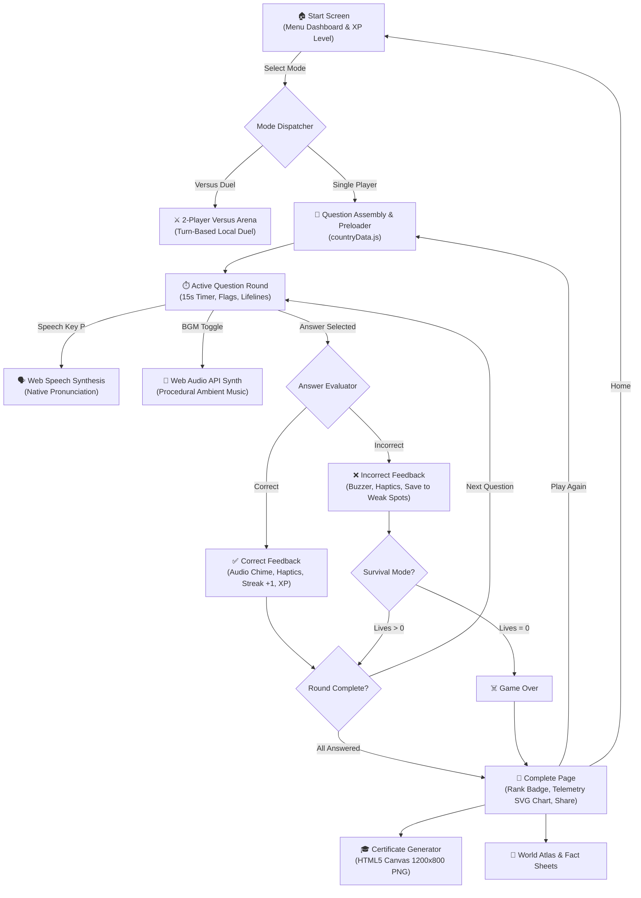
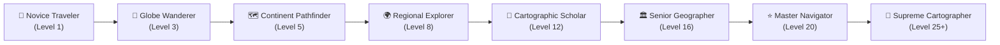

<div align="center">

  # 🌍 Country Quiz Master
  ### *The Ultimate Global Geography Expedition, 2-Player Arena & World Atlas*

  [](https://react.dev/)
  [](https://vitejs.dev/)
  [](https://tailwindcss.com/)
  [](https://www.framer.com/motion/)
  [](#-progressive-web-app-pwa)
  [](#-5-language-internationalization-i18n)
  [](#-procedural-web-audio-synthesizer--ambient-bgm)
  [](#-native-web-speech-pronunciation-engine)
  [](LICENSE)

  <br />

  <p align="center">
    <b>A premier, accessible, zero-dependency, and hyper-gamified geography expedition platform.</b>
    <br />
    Journey across 80+ sovereign nations, master high-resolution flags, challenge friends in local 2-player duels, survive sudden-death marathons, inspect dynamic continents with radar telemetry, and claim verified cartographic mastery certificates.
  </p>

  <p align="center">
    <a href="#-quick-tour--feature-matrix">Quick Tour</a> •
    <a href="#-game-modes-deep-dive">Game Modes</a> •
    <a href="#-non-functional-engineering-excellence">Engineering</a> •
    <a href="#-5-language-internationalization-i18n">Localization</a> •
    <a href="#-keyboard-power-controls">Key Controls</a> •
    <a href="#-architectural-structure">Architecture</a> •
    <a href="#-installation--local-development">Run Locally</a>
  </p>

</div>

---

## 🧭 Executive Overview

**Country Quiz Master** is an educational geography web application designed for modern desktop and mobile browsers. Built upon **React 19**, **Vite 6**, and **Tailwind CSS 4**, it merges competitive gamification mechanics with geography pedagogy.

```
╔══════════════════════════════════════════════════════════════════════════════════════════════════╗
║                                CORE CAPABILITIES AT A GLANCE                                     ║
╠══════════════════════════════════════════════════════════════════════════════════════════════════╣
║  🚩 80+ Sovereign Nations Database  │  ⚔️ 2-Player Local Pass & Play Duel Arena Mode             ║
║  📊 Head-to-Head Population Clash   │  🗣️ Native Web Speech Country Voice Pronunciation Engine   ║
║  📅 Seeded Global Daily Expeditions │  🎵 Zero-Dependency Web Audio Synth & Ambient BGM Engine   ║
║  🎯 Smart Spaced Revision Deck      │  🖼️ 1200x800 Client-Side Canvas PNG Certificate Exporter   ║
║  🏆 Sudden-Death 3-Life Survival    │  📱 Offline Progressive Web App (PWA) with Service Worker  ║
║  🌍 5-Language Engine (EN, ES, FR,  │  📈 High-Precision SVG Response-Time Performance Charts     ║
║     DE, AM)                         │  🧭 6 Explorer Persona Avatars & 28-Day Habit Heatmaps     ║
╚══════════════════════════════════════════════════════════════════════════════════════════════════╝
```

---

## 🌟 Quick Tour & Feature Matrix

<table>
  <tr>
    <td width="50%" valign="top">
      <h3>🚩 Global Flag Master</h3>
      Identify sovereign nations from crisp, high-resolution SVG and PNG national flags. Equipped with an intelligent background preloader that proactively caches upcoming question assets for instantaneous zero-latency rendering.
    </td>
    <td width="50%" valign="top">
      <h3>⚔️ 2-Player Versus Arena</h3>
      A pass-and-play local head-to-head duel mode! Player 1 (🔴 Red) and Player 2 (🔵 Blue) take turns on the same screen with live score trackers, active turn indicators, and an end-of-game victory podium.
    </td>
  </tr>
  <tr>
    <td width="50%" valign="top">
      <h3>📊 Head-to-Head Population Clash</h3>
      A high-stakes "Higher or Lower" clash! Compare national populations side-by-side with national flags, continent tags, and animated comparative population counter reveals upon answer submission.
    </td>
    <td width="50%" valign="top">
      <h3>🗣️ Native Voice Pronunciation Engine</h3>
      Press <kbd>P</kbd> or click <code>🔊</code> anywhere to hear country names and capitals spoken with authentic native accents via the browser's native Web Speech Synthesis API.
    </td>
  </tr>
  <tr>
    <td width="50%" valign="top">
      <h3>📅 Seeded Daily Challenge</h3>
      A synchronized daily challenge seeded from the calendar date (<code>YYYY-MM-DD</code>). Every player across the globe answers the identical 5 questions each day.
    </td>
    <td width="50%" valign="top">
      <h3>🎯 Weak Spot Revision Deck</h3>
      An automated revision algorithm that records missed questions in local storage and allows players to drill their historically incorrect countries until mastered.
    </td>
  </tr>
  <tr>
    <td width="50%" valign="top">
      <h3>🏆 Sudden-Death 3-Life Survival</h3>
      Marathon endurance mode. Players begin with 3 hearts (❤️❤️❤️). Incorrect answers and timer expirations cost a life. How far into the globe can you venture?
    </td>
    <td width="50%" valign="top">
      <h3>🖼️ Canvas PNG Certificate Exporter</h3>
      Generate a customized, print-ready, and downloadable $1200 \times 800$ pixel high-resolution Certificate of Cartographic Mastery directly in the browser with zero server roundtrips.
    </td>
  </tr>
</table>

---

## 🎮 Game Modes Deep-Dive

| Mode | Key Identifier | Description | Rules & Constraints | Target Audience |
| :--- | :---: | :--- | :--- | :--- |
| **🚩 Flag Master** | `flags` | Identify sovereign countries from their national flags. | 15s Timer / Relaxed | All Expeditions |
| **🏛️ Capital Cities** | `capitals` | Dual-direction matching of countries with official capitals. | 15s Timer / Relaxed | Geopolitics Enthusiasts |
| **🗺️ Wonders & Sites** | `landmarks` | Identify nations based on UNESCO landmarks and ancient monuments. | 15s Timer / Relaxed | World Travelers |
| **📊 Population Clash** | `higherLower` | Predict which of two nations possesses a higher population. | 15s Timer / Relaxed | Demographics Buffs |
| **⚔️ 2-Player Versus** | `versus` | Local pass-and-play duel between Player 1 and Player 2. | Alternating Turns | Couch Multi-player |
| **📅 Daily Challenge** | `daily` | 5 globally synchronized questions refreshed daily at midnight. | 15s Timer / Seeded | Daily Habit Builders |
| **🎯 Weak Spot Revision** | `revision` | Personalized smart queue drill targeting past mistakes. | 15s Timer / Relaxed | Exam Preparation |
| **🏆 Survival Mode** | `survival` | Sudden-death marathon with 3 lives. Go as far as you can! | 3 Lives / 15s Timer | Hardcore Players |
| **🌍 World Trivia** | `trivia` | Broad geographic trivia with live remote API fallback. | 15s Timer / Relaxed | General Trivia |
| **⚡ Time Blitz** | `timeAttack` | Rapid-fire gameplay with speed bonus score multipliers. | 15s Countdown | Speed Runners |

---

## 🏗️ State Machine & Lifecycle Flow



---

## 🛡️ Non-Functional Engineering Excellence

```
┌────────────────────────────────────────────────────────────────────────────────────────┐
│                          NON-FUNCTIONAL SPECIFICATIONS MATRIX                          │
├─────────────────────────┬──────────────────────────────────────────────────────────────┤
│ 🚀 Preloading Engine    │ Flags for upcoming 2 questions pre-cached in memory cache    │
│ 🛡️ Fault Tolerance     │ Top-level React ErrorBoundary catching edge exceptions       │
│ 🔊 Sound Synthesizer    │ Zero-dependency Web Audio API oscillator synthesis + BGM     │
│ 🗣️ Voice Synthesis     │ Web Speech API for native country & capital pronunciations   │
│ 📳 Mobile Haptics       │ Native Vibration API integration (success, warning, error)   │
│ ♿ Accessibility (a11y)  │ Screen-reader live regions, ARIA landmarks, WCAG compliance  │
│ 💾 Data Portability     │ Full player profile export and import via formatted JSON     │
│ 🖼️ Canvas PNG Rendering │ Client-side 1200x800 certificate image generator             │
│ 📱 Progressive Web App  │ Service Worker cache-first offline capability + Manifest     │
│ 📈 Performance Charts   │ Custom vector SVG response-time charts with micro-tooltips   │
└─────────────────────────┴──────────────────────────────────────────────────────────────┘
```

---

## 🌍 5-Language Internationalization (i18n)

Country Quiz Master features a client-side translation engine supporting 5 world languages:

| Language | Flag | Native Name | Code | Coverage |
| :--- | :---: | :--- | :---: | :---: |
| **English** | 🇬🇧 | English | `en` | 100% |
| **Spanish** | 🇪🇸 | Español | `es` | 100% |
| **French** | 🇫🇷 | Français | `fr` | 100% |
| **German** | 🇩🇪 | Deutsch | `de` | 100% |
| **Amharic** | 🇪🇹 | አማርኛ | `am` | 100% |

All menu titles, question labels, lifelines, result ranks, and statistics update reactively upon language selection in the Game Customizer without page reloads.

---

## 🎨 Dynamic Theme Engine

Players can shift the entire interface aesthetic between four atmospheres:

<div align="center">

| Theme | Atmosphere | Primary Accent | Background Tone |
| :--- | :--- | :---: | :---: |
| 🌌 **Cosmic Aurora** *(Default)* | Cyberpunk Deep Space | `#BC6BE8` (Magenta) | `#202446` (Obsidian Navy) |
| 🌲 **Terra Verde** | Forest Canopy Expedition | `#10B981` (Emerald) | `#152820` (Pine Deep) |
| 🌋 **Solar Flare** | Molten Volcanic Crucible | `#F97316` (Amber Red) | `#29181B` (Charcoal) |
| 🌊 **Cyber Oceanic** | Abyssal Trench Explorer | `#06B6D4` (Electric Cyan) | `#112238` (Midnight Deep) |

</div>

---

## 🏆 Player Progression & Cartographic Ranks

Career points accumulate across all game modes, elevating player status through 8 cartographic ranks:



### 🏅 Career Achievements
- 🧭 **First Steps**: Complete your first global expedition.
- 🔥 **On Fire**: Achieve a 5x answer streak combo.
- ⚡ **Unstoppable**: Sustain a 10x answer streak combo.
- 💯 **Century Club**: Successfully answer 100 questions across your career.
- 👑 **Flawless Cartographer**: Score 100% accuracy on any 10+ question game.
- 🛡️ **Survival Master**: Survive 10+ consecutive questions in Sudden-Death mode.
- ⏱️ **Lightning Reflexes**: Lock in a correct answer with >12 seconds remaining.
- 🏆 **High Roller**: Accumulate over 5,000 career points.

---

## ⌨️ Keyboard Power Controls

Engineered for desktop power users and accessibility compliance:

| Key | Operation | Action |
| :---: | :--- | :--- |
| <kbd>1</kbd> or <kbd>A</kbd> | Option A | Select the first answer option |
| <kbd>2</kbd> or <kbd>B</kbd> | Option B | Select the second answer option |
| <kbd>3</kbd> or <kbd>C</kbd> | Option C | Select the third answer option |
| <kbd>4</kbd> or <kbd>D</kbd> | Option D | Select the fourth answer option |
| <kbd>H</kbd> | Lifeline | Reveal context hint |
| <kbd>F</kbd> | Lifeline | Eliminate 2 incorrect answers (50:50) |
| <kbd>S</kbd> | Lifeline | Skip to next question |
| <kbd>P</kbd> | Accessibility | **🔊 Pronounce** country / capital aloud |
| <kbd>M</kbd> | Audio | Toggle sound effects mute |
| <kbd>B</kbd> | Music | Toggle procedural ambient BGM |
| <kbd>?</kbd> | Help | Open Keyboard Navigation Guide |
| <kbd>Esc</kbd> | Navigation | Dismiss any active modal dialog |

---

## 🏗️ Architectural Structure

```
country-quiz/
├── public/
│   ├── favicon.ico               # Application icon
│   ├── manifest.json             # PWA installable manifest
│   └── sw.js                     # Offline Service Worker caching engine
├── src/
│   ├── assets/                   # Bundled vector icons and illustrations
│   │   ├── Check_round_fill.svg
│   │   ├── Close_round_fill.svg
│   │   ├── congrats.png
│   │   └── bg.jpg
│   ├── components/               # Modular UI components
│   │   ├── AchievementsModal.jsx     # Trophy room with unlock progress
│   │   ├── CertificateModal.jsx      # HTML5 Canvas 1200x800 PNG exporter
│   │   ├── CompletePage.jsx          # Performance grade, rank, telemetry
│   │   ├── CountryFactModal.jsx      # Fact card with speech pronunciation
│   │   ├── ErrorBoundary.jsx         # Component-level crash catcher
│   │   ├── GameSettingsModal.jsx     # Mode, language, theme, audio controls
│   │   ├── Header.jsx                # Score, streak, lives, BGM, home button
│   │   ├── Lifelines.jsx             # 50:50, Hint, and Skip triggers
│   │   ├── PerformanceTelemetry.jsx  # SVG response-time telemetry chart
│   │   ├── PopulationClash.jsx       # Head-to-head population battle arena
│   │   ├── ShortcutsModal.jsx        # Keyboard navigation cheat sheet
│   │   ├── StartScreen.jsx           # Main menu dashboard & XP progress
│   │   ├── StatsModal.jsx            # 28-day habit heatmap, avatar & JSON backup
│   │   ├── StudyDeckModal.jsx        # Searchable Atlas with continent filters
│   │   ├── Timer.jsx                 # Animated countdown timer with tick audio
│   │   ├── Toast.jsx                 # Celebratory achievement unlock popups
│   │   ├── VersusDuel.jsx            # 2-Player local pass & play duel arena
│   │   └── WorldMapRadar.jsx         # Vector world map continent radar sweep
│   ├── data/
│   │   └── countryData.js            # 80+ countries database & question engines
│   ├── utils/                        # Functional utility modules
│   │   ├── achievements.js           # Achievement unlock rules & evaluator
│   │   ├── avatars.js                # 6 Explorer personas and profile logic
│   │   ├── confetti.js               # Zero-dependency canvas particle explosion
│   │   ├── haptics.js                # Mobile vibration API controller
│   │   ├── i18n.js                   # 5-language localization dictionary
│   │   ├── imagePreloader.js         # Proactive flag image background cache
│   │   ├── progression.js            # Level & XP math calculation
│   │   ├── sound.js                  # Web Audio API sound synthesizer & BGM
│   │   ├── speech.js                 # Web Speech API country pronunciation
│   │   └── themes.js                 # Dynamic visual atmosphere engine
│   ├── App.jsx                       # Master state machine & keyboard listener
│   ├── index.css                     # Tailwind CSS imports & animations
│   └── main.jsx                      # App root with ErrorBoundary protection
├── eslint.config.js                  # ESLint 9 configuration
├── index.html                        # Application entrypoint & SEO metadata
├── package.json                      # Project dependencies & scripts
├── tailwind.config.js                # Tailwind CSS styling configuration
└── vite.config.js                    # Vite bundler configuration
```

---

## 🚀 Installation & Local Development

### Prerequisites
- **Node.js** (v18.0.0 or higher recommended)
- **npm**, **pnpm**, or **yarn**

### Quick Start

```bash
# 1. Clone the repository
git clone https://github.com/kenenisabeyan/country-quiz.git

# 2. Navigate to project root
cd country-quiz

# 3. Install dependencies
npm install

# 4. Start local development server
npm run dev
```

Visit `http://localhost:5173` in your browser.

### Quality Assurance & Build Commands

```bash
# Execute ESLint validation across all source files
npm run lint

# Compile optimized static bundle for production
npm run build

# Preview production build locally
npm run preview
```

---

## 📦 Deployment

The application compiles into static HTML, JavaScript, and CSS and can be hosted on any modern static hosting service:

### Deploy to Vercel
```bash
npx vercel
```

### Deploy to Netlify
```bash
npx netlify deploy --prod --dir=dist
```

### Deploy to Cloudflare Pages
1. Connect repository in Cloudflare Pages dashboard.
2. Build command: `npm run build`
3. Output directory: `dist`

---

## 📄 License

This project is licensed under the **MIT License** — you are free to use, modify, distribute, and enhance it for personal or educational purposes.

<br />

<div align="center">

  **Crafted with care for explorers and geography enthusiasts around the globe.**

  <sub>Authored by **Kenenisa Beyan** • Contributions and Pull Requests are welcome!</sub>

</div>
